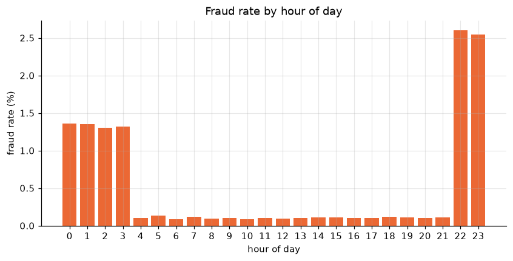
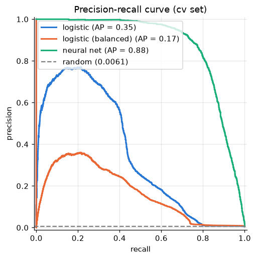

# Credit Card Fraud Detection

Detecting fraudulent credit card transactions with a neural network, built as a hands-on project alongside the [Machine Learning Specialization](https://www.coursera.org/specializations/machine-learning-introduction) (DeepLearning.AI + Stanford).

The focus is less on squeezing out the best score and more on doing each step the right way: splitting before preprocessing, choosing metrics that work with rare classes, tuning hyperparameters on a validation set, diagnosing bias vs variance, and using error analysis to decide what to build next.

## Highlights

- A small neural network reaches a **PR-AUC of 0.88** on the validation set, against **0.35** for logistic regression. The fraud patterns are non-linear (risky hours on both sides of midnight), which a linear model cannot capture.
- Searching the fraud class weight on validation found that a small weight (10) works best: PR-AUC rose from **0.46** with a weight of 400 to **0.74**, and the usual default, the class ratio (176), scored only 0.55. Training with a larger learning rate and early stopping took it to **0.86** (average of three seeds).
- Error analysis showed that both error types come from the same blind spot: the model scores each purchase on its own. **92%** of the missed frauds happen while the card is already in a fraud burst, and **85%** of the false alarms come from cards with a calm recent history.

## The problem

The [Sparkov dataset](https://www.kaggle.com/datasets/kartik2112/fraud-detection) contains 1.85 million simulated card transactions made by 999 fictional customers at 693 merchants between January 2019 and December 2020. Only **9,651 are fraud (0.52%)**.

Every column is readable: purchase amount, store category, time, cardholder age and location, store location, and the card number. That makes it possible to explain *why* the model gets a transaction wrong.

A model that never flags anything is 99.5% accurate, so accuracy is useless here. Models are evaluated on **precision, recall, F1 and PR-AUC** (the area under the precision-recall curve), which focus on the rare fraud class.

## What the data shows

- Fraudulent purchases are much larger (median 390 vs 47).
- Fraud concentrates at night: from 22h to 3h the fraud rate is 10 to 25 times higher than during the day.
- Online shopping and groceries carry about 10 times the fraud rate of restaurants.
- Fraud arrives in bursts: a compromised card suffers about 10 fraudulent purchases within roughly two days.



## Approach

1. **Split by time.** Train on 2019, validate (cv) on January to June 2020, and test on Kaggle's own test file (June to December 2020). This mimics production: train on the past, predict the future. The test set is reserved for a single final evaluation.
2. **Preprocess with training statistics only.** Features are built per transaction (log amount, hour, day of week, age, city size, home-to-store distance, store category, gender). Numeric features are standardized and categories one-hot encoded, both fitted on the training set.
3. **Baselines.** A lazy model that always predicts "legit", and logistic regression with and without class weights.
4. **Neural network** in Keras: two small ReLU layers, a sigmoid output, binary cross-entropy and L2 regularization.
5. **Hyperparameter search on cv.** The fraud class weight (five values) and the training setup (learning rate and early stopping), each with three seeds, so real effects can be told apart from run-to-run noise.
6. **Diagnosis and error analysis.** Learning curves (J_train vs J_cv), then a sample of 100 missed frauds and 100 false alarms, tagged and counted as taught in the course. The strategies are written up in [docs/error-analysis.md](docs/error-analysis.md).
7. **Decision threshold by cost.** A missed fraud costs its purchase amount and a false alarm a fixed $10; the threshold is the one with the lowest total cost on cv.

## Results (cv set)

| Model | Precision | Recall | F1 | PR-AUC |
|---|---:|---:|---:|---:|
| Lazy (always "legit") | 0.000 | 0.000 | 0.000 | 0.006 |
| Logistic regression | 0.706 | 0.084 | 0.150 | 0.351 |
| Logistic regression (balanced weights) | 0.018 | 0.743 | 0.035 | 0.165 |
| **Neural network** | **0.718** | **0.841** | **0.775** | **0.876** |

Precision, recall and F1 use the default 0.5 threshold; PR-AUC is threshold-free. The neural network row is seed 0 of the final setup; across three seeds its PR-AUC is 0.855 ± 0.022.



### Choosing the fraud weight

`class_weight` makes each fraud count more in the cost function. The class ratio (176) is a common default, but it made the network flag far too much:

| Fraud weight | PR-AUC (mean of 3 seeds) | Missed frauds | False alarms |
|---:|---:|---:|---:|
| 1 | 0.53 | 1,756 | 95 |
| **10** | **0.74** | 456 | 1,169 |
| 50 | 0.65 | 177 | 5,170 |
| 176 | 0.55 | 56 | 14,725 |
| 400 | 0.46 | 28 | 24,772 |

### Training longer, with early stopping

With the weight fixed, the learning curves were still going down at epoch 100. A 10x larger learning rate with early stopping on J_cv improved PR-AUC and reduced the variation between seeds:

| Setup | PR-AUC (mean of 3 seeds) | Std |
|---|---:|---:|
| lr 1e-4, fixed 100 epochs | 0.736 | 0.059 |
| **lr 1e-3, early stopping** | **0.855** | **0.022** |
| lr 1e-4, early stopping (up to 300 epochs) | 0.804 | 0.044 |

J_train and J_cv stay together for the whole run, so the final network shows no sign of overfitting.

### Error analysis

At the 0.5 threshold the network misses 363 of 2,286 frauds and flags 754 legit purchases.

- **Missed frauds are small purchases inside a burst.** Their median amount is about $21, and 92 of 100 sampled happen in low-risk stores. In 92 of the 100, the same card had already made a large purchase in the previous 24 hours.
- **False alarms are large, isolated purchases.** 80 of 100 are above $200, but 85 come from cards with a calm recent history, like ordinary customers.

Both point to the same next step: features describing each card's recent activity, computed only from its earlier purchases.

### Decision threshold

A missed fraud costs the bank its purchase amount (the customer is refunded), and a false alarm is assumed to cost $10 (support call, blocked card, annoyed customer). Trying every threshold on cv:

| | Threshold 0.5 | Threshold 0.23 (cheapest) |
|---|---:|---:|
| Missed frauds | 363 | 204 |
| Amount lost to missed frauds | $54,419 | $17,942 |
| False alarms | 754 | 2,722 |
| **Total cost** | **$61,959** | **$45,162** |

The cost-based threshold is 27% cheaper than the default, and the model avoids 96% of the $1.22 million that frauds would cost with no model. The choice depends on the assumed false alarm cost: the threshold stays at 0.23 for $5 to $10, and moves to 0.53 at $50.


## Project structure

```
fraud-detection/
├── src/
│   ├── data.py               # loading and the time-based train/cv/test split
│   ├── features.py           # feature engineering, train-only scaling and encoding
│   ├── train.py              # baselines, the neural network and its training loop
│   ├── evaluate.py           # metrics, confusion matrix, PR curves
│   ├── error_analysis.py     # error sampling, tagging and card-history counts
│   ├── tune_fraud_weight.py  # search for the fraud class weight
│   └── tune_training.py      # search for the learning rate and stopping rule
├── notebooks/
│   ├── 01_eda.ipynb
│   ├── 02_baselines.ipynb
│   ├── 03_neural_network.ipynb
│   └── 04_threshold.ipynb
├── docs/
│   └── error-analysis.md     # error analysis strategies and how they were applied
├── reports/
│   ├── figures/              # plots used in this README and the notebooks
│   ├── fraud_weight_search.csv
│   └── training_search.csv
└── tests/                    # pipeline tests on synthetic data
```

## Running it

Requires Python 3.12 and a free [Kaggle API token](https://www.kaggle.com/settings) to download the data.

```bash
uv venv --python 3.12 .venv
uv pip install --python .venv/bin/python -r requirements.txt

.venv/bin/kaggle datasets download -d kartik2112/fraud-detection -p data/sparkov --unzip

.venv/bin/python -m src.train              # baseline table
.venv/bin/python -m src.tune_fraud_weight  # fraud weight search (about 20 minutes)
.venv/bin/python -m src.tune_training      # learning rate search (about 20 minutes)
.venv/bin/pytest                           # tests
.venv/bin/jupyter lab                      # notebooks
```

## Limitations

- **Simulated data.** The transactions come from a simulator, not a real bank. Patterns are cleaner and more regular than in real life (for example, every compromised card follows the same two-day burst), so scores here would not transfer to real data.
- **Some features carry no signal by construction.** The simulator places stores at random near the cardholder, so home-to-store distance does not help, even though it often does with real data.
- **Drift.** The monthly fraud rate moves between about 0.2% and 1%, so a model in production would need monitoring and periodic retraining.
- **Each transaction is scored on its own.** The model does not yet know what is normal for each card, which the error analysis identifies as the main source of both missed frauds and false alarms.

## Next steps

1. Card-history features: purchases, night purchases and large purchases on the same card in the last 24 hours.
2. A single final evaluation on the test set.
3. A FastAPI service that serves the model, with Docker and CI.

## Credits

- Data: [Credit Card Transactions Fraud Detection Dataset](https://www.kaggle.com/datasets/kartik2112/fraud-detection) published on Kaggle by kartik2112, released under CC0 1.0 and generated with the [Sparkov Data Generation](https://github.com/namebrandon/Sparkov_Data_Generation) tool by Brandon Harris.
- Course: [Machine Learning Specialization](https://www.coursera.org/specializations/machine-learning-introduction) by DeepLearning.AI and Stanford University, taught by Andrew Ng.

## License

[MIT](LICENSE)
