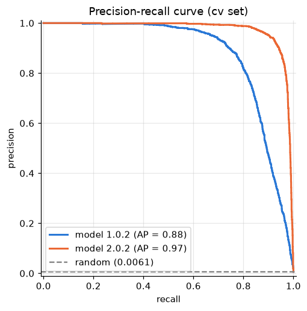
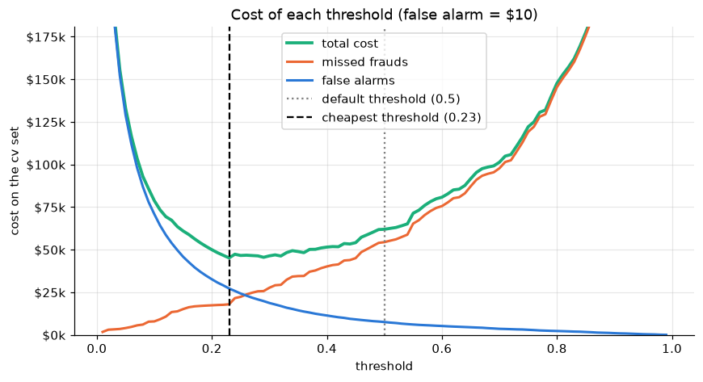
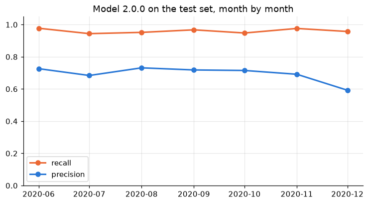

# Credit Card Fraud Detection

[](https://github.com/felipersas/fraud-detection/actions/workflows/ci.yml)
[](LICENSE)

Detecting fraudulent credit card transactions with a neural network, built as a hands-on project alongside the [Machine Learning Specialization](https://www.coursera.org/specializations/machine-learning-introduction) (DeepLearning.AI + Stanford).

The focus is less on squeezing out the best score and more on doing each step the right way: splitting before preprocessing, choosing metrics that work with rare classes, tuning hyperparameters on a validation set, diagnosing bias vs variance, using error analysis to decide what to build next, and serving the result the way a production model would be: versioned, validated, containerized and tested.

## Highlights

- A small neural network reaches a **PR-AUC of 0.88** on the validation set, against **0.35** for logistic regression. The fraud patterns are non-linear (risky hours on both sides of midnight), which a linear model cannot capture.
- Searching the fraud class weight on validation found that a small weight (10) works best: PR-AUC rose from **0.46** with a weight of 400 to **0.74**, and the usual default, the class ratio (176), scored only 0.55. Training with a larger learning rate and early stopping took it to **0.86** (average of three seeds).
- Error analysis showed that both error types come from the same blind spot: the model scores each purchase on its own. **92%** of the missed frauds happen while the card is already in a fraud burst, and **85%** of the false alarms come from cards with a calm recent history.
- Acting on it, model 2.0.0 adds features from each card's recent purchases. PR-AUC rises to **0.966** (three seeds), and at the cost-based threshold **both error types fall together**: missed frauds from 204 to **56**, false alarms from 2,722 to **752**, halving the cost on cv.
- On the **test set**, untouched until the end, model 2.0.0 scores a PR-AUC of **0.959** (0.973 on cv) and catches **95.8%** of frauds with 69% precision, avoiding 97% of the fraud cost.
- Each model ships as a **12 KB versioned bundle** of plain arrays and JSON, served by a FastAPI app that runs the network in NumPy: the API image (308 MB) needs neither TensorFlow nor scikit-learn. Card history lives in Redis, shared by every replica and kept across restarts, and a test checks the serving computation matches training exactly. Switching versions or rolling back is one environment variable, each model is a GitHub release, and CI lints, type-checks and tests every package, the image and the API with Redis.

## The problem

The [Sparkov dataset](https://www.kaggle.com/datasets/kartik2112/fraud-detection) contains 1.85 million simulated card transactions made by 999 fictional customers at 693 merchants between January 2019 and December 2020. Only **9,651 are fraud (0.52%)**.

Every column is readable: purchase amount, store category, time, cardholder age and location, store location, and the card number. That makes it possible to explain *why* the model gets a transaction wrong.

A model that never flags anything is 99.5% accurate, so accuracy is useless here. Models are evaluated on **precision, recall, F1 and PR-AUC** (the area under the precision-recall curve), which focus on the rare fraud class.

## What the data shows

- Fraudulent purchases are much larger (median 390 vs 47).
- Fraud concentrates at night: from 22h to 3h the fraud rate is 10 to 25 times higher than during the day.
- Online shopping and groceries carry about 10 times the fraud rate of restaurants.
- Fraud arrives in bursts: a compromised card suffers about 10 fraudulent purchases within roughly two days.


## Approach

1. **Split by time.** Train on 2019, validate (cv) on January to June 2020, and test on Kaggle's own test file (June to December 2020). This mimics production: train on the past, predict the future. The test set is reserved for a single final evaluation.
2. **Preprocess with training statistics only.** Features are built per transaction (log amount, hour, day of week, age, city size, home-to-store distance, store category, gender). Numeric features are standardized and categories one-hot encoded, both fitted on the training set.
3. **Baselines.** A lazy model that always predicts "legit", and logistic regression with and without class weights.
4. **Neural network** in Keras: two small ReLU layers, a sigmoid output, binary cross-entropy and L2 regularization.
5. **Hyperparameter search on cv.** The fraud class weight (five values) and the training setup (learning rate and early stopping), each with three seeds, so real effects can be told apart from run-to-run noise.
6. **Diagnosis and error analysis.** Learning curves (J_train vs J_cv), then a sample of 100 missed frauds and 100 false alarms, tagged and counted as taught in the course. The strategies are written up in [docs/error-analysis.md](docs/error-analysis.md).
7. **Decision threshold by cost.** A missed fraud costs its purchase amount and a false alarm a fixed $10; the threshold is the one with the lowest total cost on cv.
8. **Card-history features (model 2.0.0).** What the same card did in the previous 24 hours, computed only from its earlier purchases, as the error analysis suggested.
9. **Versioned model bundle.** `fraud-train` retrains the final network, picks the threshold and exports a small, self-describing bundle that the API can load without TensorFlow.
10. **Serving.** A FastAPI service scores transactions with the bundle, validates inputs against what the model was trained on, keeps card history in Redis, and ships as a Docker image tested in CI.
11. **Final evaluation.** The published models are scored once on the test set, after every decision was taken.

## Results (cv set)

| Model | Precision | Recall | F1 | PR-AUC |
|---|---:|---:|---:|---:|
| Lazy (always "legit") | 0.000 | 0.000 | 0.000 | 0.006 |
| Logistic regression | 0.706 | 0.084 | 0.150 | 0.351 |
| Logistic regression (balanced weights) | 0.018 | 0.743 | 0.035 | 0.165 |
| Neural network (model 1.0.0) | 0.718 | 0.841 | 0.775 | 0.876 |
| **Neural network + card history (model 2.0.0)** | **0.828** | **0.965** | **0.891** | **0.973** |

Precision, recall and F1 use the default 0.5 threshold; PR-AUC is threshold-free. The neural network rows are the published bundles (seed 0); across three seeds, PR-AUC is 0.855 ± 0.022 without card history and 0.966 ± 0.011 with it.



### Choosing the fraud weight

`class_weight` makes each fraud count more in the cost function. The class ratio (176) is a common default, but it made the network flag far too much:

| Fraud weight | PR-AUC (mean of 3 seeds) | Missed frauds | False alarms |
|---:|---:|---:|---:|
| 1 | 0.53 | 1,756 | 95 |
| **10** | **0.74** | 456 | 1,169 |
| 50 | 0.65 | 177 | 5,170 |
| 176 | 0.55 | 56 | 14,725 |
| 400 | 0.46 | 28 | 24,772 |

### Training longer, with early stopping

With the weight fixed, the learning curves were still going down at epoch 100. A 10x larger learning rate with early stopping on J_cv improved PR-AUC and reduced the variation between seeds:

| Setup | PR-AUC (mean of 3 seeds) | Std |
|---|---:|---:|
| lr 1e-4, fixed 100 epochs | 0.736 | 0.059 |
| **lr 1e-3, early stopping** | **0.855** | **0.022** |
| lr 1e-4, early stopping (up to 300 epochs) | 0.804 | 0.044 |

J_train and J_cv stay together for the whole run, so the final network shows no sign of overfitting.

### Error analysis

At the 0.5 threshold the network misses 363 of 2,286 frauds and flags 754 legit purchases.

- **Missed frauds are small purchases inside a burst.** Their median amount is about $21, and 92 of 100 sampled happen in low-risk stores. In 92 of the 100, the same card had already made a large purchase in the previous 24 hours.
- **False alarms are large, isolated purchases.** 80 of 100 are above $200, but 85 come from cards with a calm recent history, like ordinary customers.

Both point to the same next step: features describing each card's recent activity, computed only from its earlier purchases.

### Decision threshold

A missed fraud costs the bank its purchase amount (the customer is refunded), and a false alarm is assumed to cost $10 (support call, blocked card, annoyed customer). Trying every threshold on cv:

| | Threshold 0.5 | Threshold 0.23 (cheapest) |
|---|---:|---:|
| Missed frauds | 363 | 204 |
| Amount lost to missed frauds | $54,419 | $17,942 |
| False alarms | 754 | 2,722 |
| **Total cost** | **$61,959** | **$45,162** |

The cost-based threshold is 27% cheaper than the default, and the model avoids 96% of the $1.22 million that frauds would cost with no model. The choice depends on the assumed false alarm cost: the threshold stays at 0.23 for $5 to $10, and moves to 0.53 at $50.



### Card history (model 2.0.0)

The error analysis pointed at one missing piece of information: what the same card did just before each purchase. Model 2.0.0 adds five features, computed by `fraud_core.history` from **strictly earlier purchases of the same card** and no fraud labels, so nothing leaks from the future:

| Feature | Legit (mean) | Fraud (mean) |
|---|---:|---:|
| purchases in the previous 24 hours | 4.1 | 4.3 |
| night purchases in the previous 24 hours | 0.9 | 3.3 |
| large purchases (over $200) in the previous 24 hours | 0.2 | 2.8 |
| amount spent in the previous 24 hours | $280 | $1,950 |
| hours since the previous purchase | 9.3 | 12.9 |

Frauds do not come with more purchases, they come with different ones. Comparing both published models, each at its own cost-based threshold:

| | Model 1.0.0 | Model 2.0.0 |
|---|---:|---:|
| Threshold | 0.23 | 0.35 |
| Missed frauds | 204 | **56** |
| of which: card already in a burst | 194 | 20 |
| False alarms | 2,722 | **752** |
| of which: calm card history | 2,316 | 310 |
| **Total cost on cv** | **$45,162** | **$21,917** |

A threshold can only trade one error for the other; reducing both at once needs better information, and the groups the error analysis singled out are exactly the ones that shrank. Across three seeds the result holds: 55 ± 13 missed frauds and 989 ± 217 false alarms, against 230 ± 31 and 2,824 ± 179 without card history. See `training/notebooks/05_card_history.ipynb`.

## Final evaluation on the test set

Every decision was taken on cv, which makes cv numbers slightly optimistic. The test set (21 June to 31 December 2020) was scored **once**, at the end, with each published model at the threshold it was released with:

| | Model 1.0.0 | Model 2.0.0 |
|---|---:|---:|
| PR-AUC (cv / test) | 0.876 / 0.833 | 0.973 / **0.959** |
| Recall on test | 88.5% | **95.8%** |
| Precision on test | 33.4% | **69.4%** |
| Missed frauds (of 2,145) | 246 | **90** |
| False alarms | 3,789 | **906** |
| **Cost on test** | **$58,611** | **$32,608** |

Approving everything would have cost $1.13 million over the same period. Month by month, model 2.0.0 keeps recall between 94% and 98%; precision holds around 0.7 and dips to 0.59 in December, when purchase volume nearly doubles and the fraud rate falls to 0.19%. That is base-rate drift, the kind of change monitoring should catch. No model was changed after seeing these numbers. See `training/notebooks/06_test_evaluation.ipynb`.



## The model bundle

`uv run fraud-train --version 2.1.0 --card-history` (from `training/`) retrains the final network and writes `models/2.1.0/`; without `--card-history` it builds a 1.x model that scores each purchase on its own. Each bundle holds:

| File | Contents |
|---|---|
| `weights.npz` | weights and bias of each Dense layer, and each layer's activation |
| `preprocessor.json` | what the feature pipeline learned on the training set: means, scales and categories |
| `metadata.json` | version, git commit, training and cv periods, training setup, threshold, cost model, cv metrics and whether the model needs card history |

A trained Dense network only computes `activation(X @ W + b)` layer after layer, so `fraud_core.model` runs it with NumPy. The preprocessor's standardization and one-hot encoding are plain NumPy too, matching scikit-learn's bit for bit (tested), so serving needs neither TensorFlow nor scikit-learn, and loading a bundle never executes pickled code. Before publishing, `fraud-train` reloads the bundle exactly as serving will and checks that it reproduces the Keras predictions on cv; a version folder is never overwritten.

Bundles 1.0.0 and 2.0.0 predate the JSON format and pickle scikit-learn objects. Rather than rewriting published versions, `fraud-repackage` republished them as **1.0.1 and 2.0.1**: same weights, statistics and thresholds, with predictions checked identical on all of cv. A patch version signals exactly that, a new package with unchanged behaviour. The API serves only the JSON bundles.

Each version is also a [GitHub release](https://github.com/felipersas/fraud-detection/releases) with the bundle attached: pushing a tag such as `model-2.0.1` runs [release-model.yml](.github/workflows/release-model.yml), which packages `models/2.0.1` and writes the notes from its metadata.

## The API

`fraud-api` loads a model bundle at startup (the highest version in `models/`, or the one in `FRAUD_MODEL_VERSION`, which also makes rolling back a one-variable change) and exposes:

| Endpoint | What it does |
|---|---|
| `GET /health` | liveness check and the served model version |
| `GET /model` | how the served model was trained, its threshold, cv metrics and accepted categories |
| `POST /predict` | scores one transaction |
| `POST /predict/batch` | scores up to 1,000 transactions |
| `GET /docs` | interactive documentation generated by FastAPI |

```bash
curl -X POST localhost:8000/predict -H 'content-type: application/json' -d '{
  "transaction_time": "2020-06-17T00:33:41", "amount": 1167.06, "category": "shopping_net",
  "gender": "F", "date_of_birth": "1985-03-02", "city_population": 2500,
  "customer_latitude": 40.71, "customer_longitude": -74.0,
  "merchant_latitude": 40.95, "merchant_longitude": -73.6, "card_id": "card-0001"
}'
```

```json
{"fraud_probability": 0.982885, "is_fraud": true, "threshold": 0.35, "model_version": "2.0.1"}
```

Card-history models need `card_id`. Before scoring, the API reads that card's purchases from the previous 24 hours, computes the same five features as training, then records the new purchase; a batch is processed in time order, and a lock keeps concurrent requests for one card consistent. A test replays random purchase sequences through this path and through the training code and checks they agree exactly, which guards against training-serving skew. Model 1.x ignores `card_id`.

With `REDIS_URL` set, card history lives in Redis: each card is a sorted set of its purchases scored by time, so the history is one range query, shared by every replica and kept across restarts. Cards are locked across replicas while their history is read and updated, and `/health` answers 503 when Redis is down, so a load balancer stops sending traffic. Without `REDIS_URL` the history stays in memory, which suits a single instance. `docker compose up --build` starts the API with Redis, persisted to disk.

Inputs are validated before scoring: amounts must be positive, coordinates within range, and the store category one the model saw in training. An unseen category would otherwise be encoded as "none of them" and produce a score the model was never trained for, so it is rejected with a 422 instead. Every request logs the number of transactions, how many were flagged, the model version and the latency, which is the raw material for monitoring.

The Docker image installs only `fraud-api` and `fraud-core` (308 MB, down from 518 MB once scikit-learn and SciPy were no longer needed), runs as a non-root user and has a health check. CI ([.github/workflows/ci.yml](.github/workflows/ci.yml)) runs ruff and mypy, every package's tests, builds and smoke tests the image, and starts the API with Redis to check that card history survives an API restart.

## Project structure

The repository is a [uv workspace](https://docs.astral.sh/uv/concepts/projects/workspaces/): several Python packages that share one lockfile and one virtual environment. Feature engineering lives in its own package, `fraud-core`, used by both training and the API, so a transaction is always transformed the same way in both places. Keeping that code in one place avoids training-serving skew, where a model silently degrades in production because its inputs are computed differently from training.

```
fraud-detection/
├── pyproject.toml                # workspace root: members and dev tools
├── .github/workflows/
│   ├── ci.yml                    # lint, types, tests, image and API-with-Redis checks
│   └── release-model.yml         # publish a model bundle as a GitHub release from a tag
├── compose.yaml                  # the API with Redis for card history
├── uv.lock                       # exact versions of every dependency
├── packages/
│   └── fraud-core/               # shared by training and serving (numpy and pandas only)
│       └── src/fraud_core/
│           ├── columns.py        # names of the raw columns
│           ├── features.py       # feature engineering, train-only scaling and encoding
│           ├── history.py        # card-history features, for a table and one purchase at a time
│           └── model.py          # load a model bundle and score transactions with NumPy
├── training/                     # everything needed to build the model (TensorFlow, Jupyter)
│   ├── src/fraud_training/
│   │   ├── data.py               # loading and the time-based train/cv/test split
│   │   ├── train.py              # baselines, the neural network and its training loop
│   │   ├── export.py             # fraud-train: train the final model and export a bundle
│   │   ├── repackage.py          # fraud-repackage: republish a bundle in the current format
│   │   ├── evaluate.py           # metrics, PR curves and cost by threshold
│   │   ├── error_analysis.py     # error sampling, tagging and card-history counts
│   │   ├── tune_fraud_weight.py  # search for the fraud class weight
│   │   ├── tune_training.py      # search for the learning rate and stopping rule
│   │   └── compare_card_history.py  # three-seed comparison with and without card history
│   ├── notebooks/                # 01 EDA … 05 card history, 06 final test evaluation
│   ├── reports/                  # figures and search results
│   └── tests/
├── api/                          # FastAPI service (fraud-core, FastAPI, Uvicorn; no TensorFlow)
│   ├── src/fraud_api/
│   │   ├── main.py               # endpoints, input validation, card history and request logging
│   │   └── history_store.py      # card history in Redis
│   ├── scripts/                  # compose smoke test
│   ├── Dockerfile
│   └── tests/
├── models/                       # published model bundles, one folder per version
├── docs/
│   └── error-analysis.md         # error analysis strategies and how they were applied
└── conftest.py                   # test fixtures shared by every package
```

## Running it

Requires [uv](https://docs.astral.sh/uv/) and a free [Kaggle API token](https://www.kaggle.com/settings) to download the data. uv installs Python 3.12 and every package from the lockfile.

```bash
uv sync                                      # create .venv with all workspace packages

cd training
uv run kaggle datasets download -d kartik2112/fraud-detection -p data/sparkov --unzip
uv run fraud-baselines                       # baseline table
uv run fraud-tune-weight                     # fraud weight search (about 20 minutes)
uv run fraud-tune-training                   # learning rate search (about 20 minutes)
uv run fraud-compare-card-history           # with vs without card history (about 30 minutes)
uv run fraud-train --version 2.1.0 --card-history  # export a new bundle to models/ (about 5 minutes)
uv run jupyter lab notebooks                 # notebooks
cd ..

uv run pytest                                # tests for every package
uv run fraud-api                             # serve the latest model on localhost:8000

docker compose up --build                    # the API with Redis on localhost:8000

docker build -f api/Dockerfile -t fraud-api .
docker run -p 8000:8000 fraud-api                                 # serves 2.0.1, history in memory
docker run -p 8000:8000 -e FRAUD_MODEL_VERSION=1.0.1 fraud-api    # rolls back to 1.0.1

uv run ruff check . && uv run ruff format --check . && uv run mypy packages/fraud-core/src api/src training/src
```

## Limitations

- **Simulated data.** The transactions come from a simulator, not a real bank. Patterns are cleaner and more regular than in real life (for example, every compromised card follows the same two-day burst), so scores here would not transfer to real data.
- **Some features carry no signal by construction.** The simulator places stores at random near the cardholder, so home-to-store distance does not help, even though it often does with real data.
- **Drift.** The monthly fraud rate moves between about 0.2% and 1%, and precision on test dipped in December; a model in production needs monitoring and periodic retraining.
- **Cold start.** Redis keeps card history across restarts, but a brand-new deployment starts empty and sees every card as quiet until traffic arrives; it should be warmed up from recent transactions first.

## Next steps

1. Monitoring: the per-request logs already carry volume, flag rate and model version; exporting them as metrics (Prometheus and Grafana, for instance) and alerting on a shifting flag rate would catch drift like December's.
2. Warm up card history from recent transactions before a new deployment takes traffic.
3. A scheduled retraining pipeline that trains on the latest data, publishes a new version only if it beats the current one on fresh cv data, and keeps rollback one variable away.

## Credits

- Data: [Credit Card Transactions Fraud Detection Dataset](https://www.kaggle.com/datasets/kartik2112/fraud-detection) published on Kaggle by kartik2112, released under CC0 1.0 and generated with the [Sparkov Data Generation](https://github.com/namebrandon/Sparkov_Data_Generation) tool by Brandon Harris.
- Course: [Machine Learning Specialization](https://www.coursera.org/specializations/machine-learning-introduction) by DeepLearning.AI and Stanford University, taught by Andrew Ng.

## License

[MIT](LICENSE)
